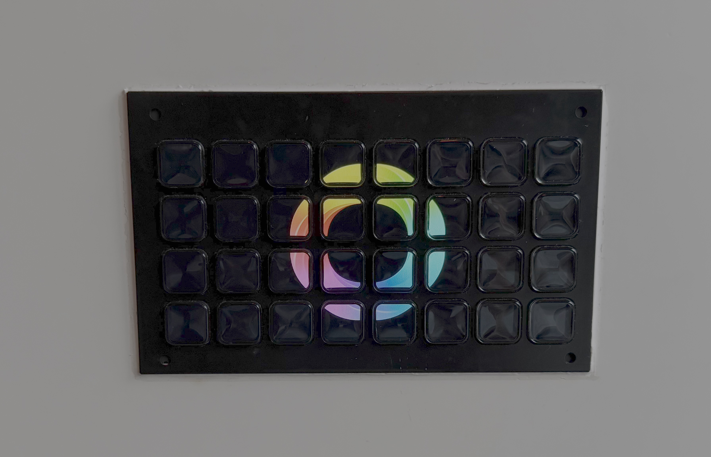
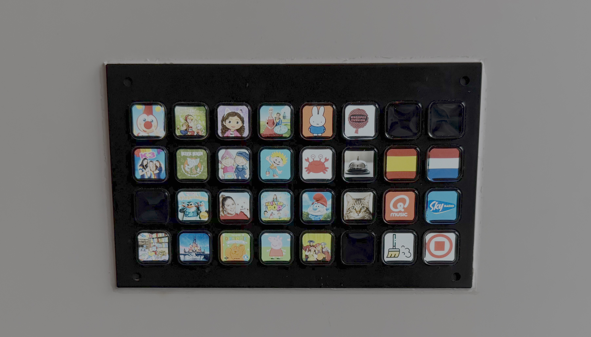
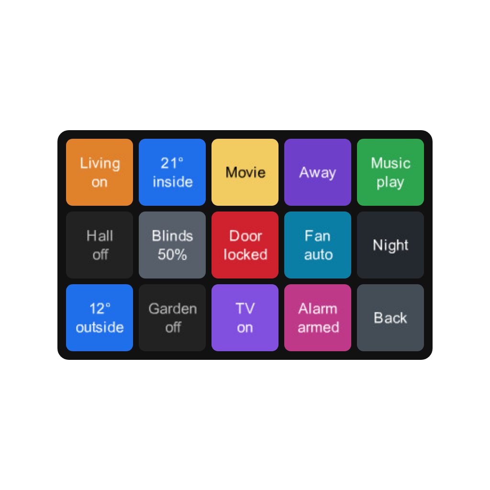
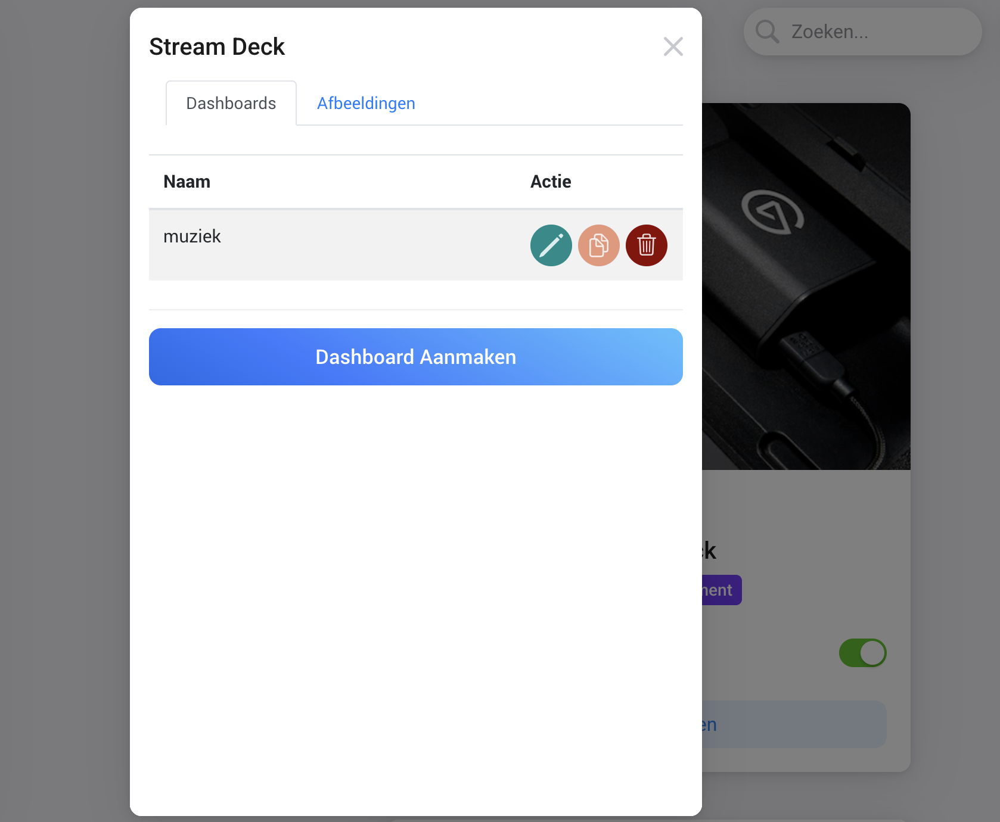
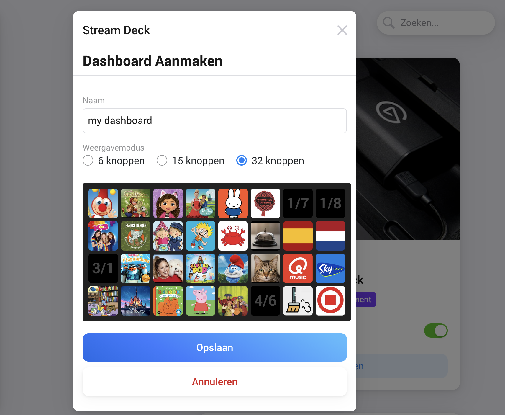
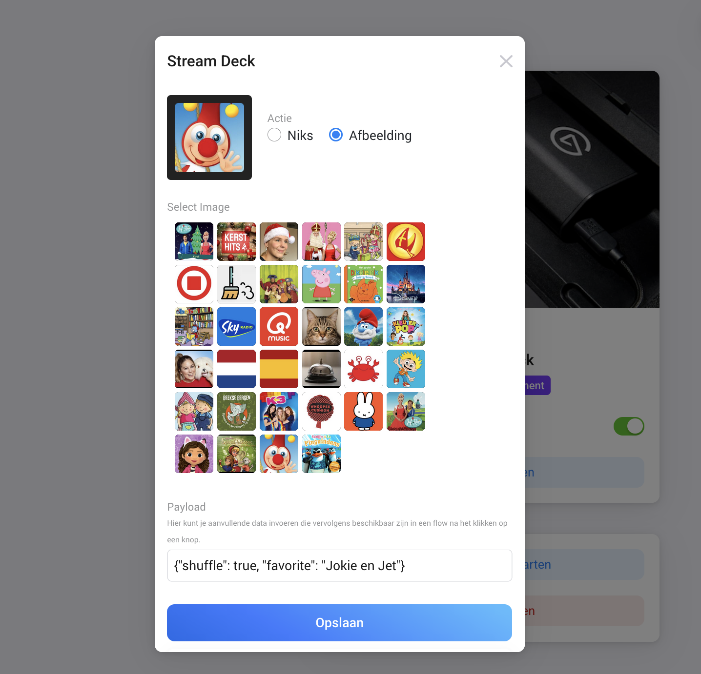
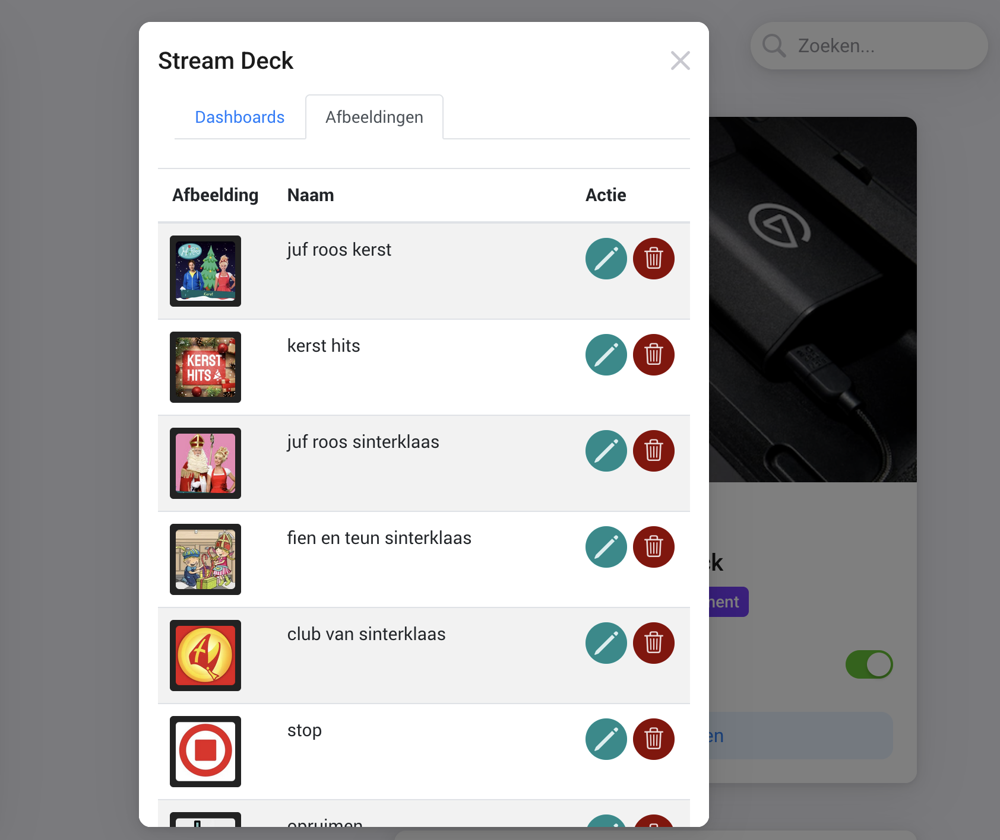
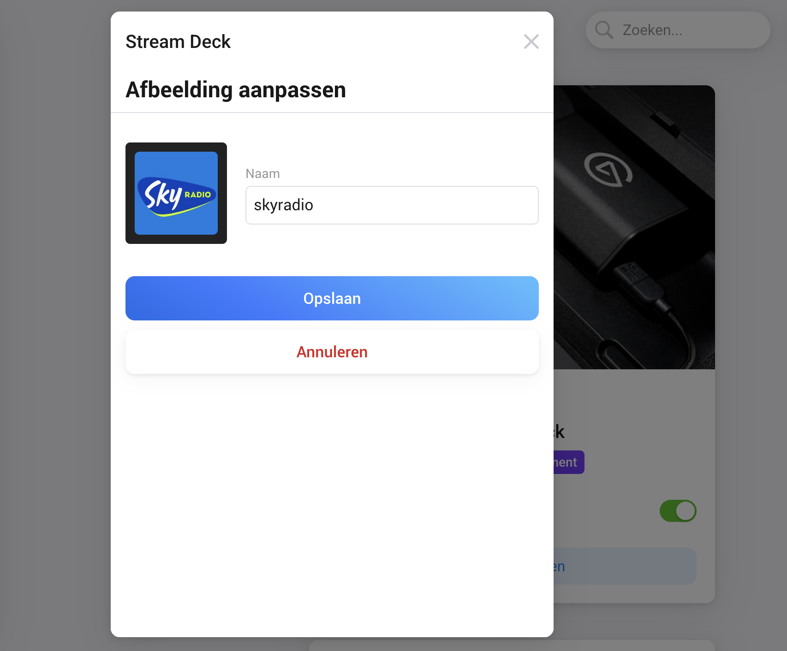

# Stream Deck for Homey

Control your Homey smart home directly from your Stream Deck — instantly, over your local network, without any cloud dependency.

**Download:** 
Stable version: [Stream Deck | Homey](https://homey.app/a/nl.stefanrenne.streamdeck) 
Test version: [Stream Deck | Homey](https://homey.app/a/nl.stefanrenne.streamdeck/test)

## Features

**Dashboards** 
Organise your buttons into multiple named dashboards and switch between them from a Homey Flow. Build a "Morning" dashboard, a "Movie Night" layout, or any setup that fits your routine — then let Homey switch them automatically based on time, presence, or any other trigger.

**Navigation Between Dashboards** 
Turn any button into a menu key: in the dashboard editor, a button has a *Display* (empty, variable or image) and an optional *Action*. *Open dashboard* shows another dashboard and can return to the previous one by itself after a number of seconds without a button press; *Back* returns to the dashboard you came from. Build a lighting sub-menu that closes itself, without writing a single Flow. The button still runs its flows as usual.

**Custom Images** 
Upload your own JPG or PNG images and assign them to buttons. Select multiple images at once during upload. Every button gets a clear, personalised icon.

**Dynamic Variables** 
Create variable buttons that display two lines of live text — temperature, a device state, a countdown, or any value your flows produce. Set custom text and background colours per variable, and update the content in real time using Flow actions.

**Brightness Control** 
Turn the Stream Deck on or off and dim the screen directly from Homey using the standard on/off and dim capabilities.

**Virtual Stream Deck** 
No Stream Deck at hand, or want one on your wall tablet too? Add a *Virtual Stream Deck* device (Mini, Neo, +, MK.2 or XL layout) and put the *Virtual Stream Deck* widget on a Homey dashboard. It shows the same dashboards, images and live variables as a real deck, and pressing its keys fires the same Flow cards, including single and double presses. Dashboards, brightness and on/off work exactly as on hardware, and you can change the model later in the device settings.

**Auto-Discovery** 
The app automatically detects your Stream Deck Network Dock on the local network via mDNS, so setup takes seconds.

---

## Flow Cards

### Triggers (When)
| Card | Description | Tokens |
|------|-------------|--------|
| Turned on / off | Fires when the Stream Deck is turned on or off | — |
| Brightness changed | Fires when the brightness level changes | `dim` (0–1) |
| Dashboard has changed | Fires when the active dashboard changes | `dashboard` |
| Button action | Fires on any button event | `dashboard`, `imageName`, `textFirstLine`, `textSecondLine`, `payload`, `column`, `row`, `item` |
| Image button action | Fires when a button assigned to an image is triggered | `dashboard`, `payload`, `column`, `row`, `item` |
| Variable button action | Fires when a button assigned to a variable is triggered | `dashboard`, `textFirstLine`, `textSecondLine`, `payload`, `column`, `row`, `item` |
| Disabled button action | Fires when a button is pressed, released, single or double pressed (you choose which) while the Stream Deck is turned off | `column`, `row`, `item` |

All button triggers support filtering by action type: **pressed** (down), **released** (up), **single pressed**, or **double pressed**. A double press is two presses on the same button within 250 ms; a single press fires 400 ms after a press that wasn't followed by a second one.

`column` and `row` start at 1. `item` names the button the same way the dashboard editor does: a row letter plus a column number (`A1` is top left, `B3` is the second row, third column). `payload` is the free text you entered for that button in the dashboard editor.

### Conditions (And)
| Card | Description |
|------|-------------|
| Is turned on | Check whether the Stream Deck is currently on |
| Brightness is less than / greater than | Check the current brightness level |
| Dashboard is | Check whether a specific dashboard is currently active |

### Actions (Then)
| Card | Description |
|------|-------------|
| Turn on / off / toggle | Turn the Stream Deck on, off, or toggle it |
| Set brightness | Set the brightness to a specific percentage |
| Set dashboard | Switch to a specific dashboard |
| Update variable | Set both lines of text on a variable button |
| Update variable – first line | Update only the first line of a variable button |
| Update variable – second line | Update only the second line of a variable button |

---

## Configuration

Open the app settings in Homey to manage your dashboards, images, and variables. Use Stream Deck Studio to map each button to your Homey setup and assign custom payloads.

List and manage dashboards:

Create / Edit dashboard:

Update dashboard item:

List and manage images:

Edit image:

---

## Requirements

For a real Stream Deck:

- Stream Deck Studio
- Stream Deck Network Dock, with one of the following devices:
  - Stream Deck Module 6
  - Stream Deck Module 15
  - Stream Deck Module 32
  - Stream Deck Mini
  - Stream Deck Classic
  - Stream Deck Scissor Keys
  - Stream Deck XL
  - Stream Deck neo (LCD buttons only)
  - Stream Deck + (LCD buttons only)

For a virtual Stream Deck: nothing but Homey. Add the device under *Devices* and the widget on a Homey dashboard, then choose the device in the widget settings.

Every Flow card below works for both kinds of deck.

---

## Contributing

See [CONTRIBUTING.md](./CONTRIBUTING.md) for guidelines.

---

## Powered by

- [node-elgato-stream-deck](https://github.com/Julusian/node-elgato-stream-deck)
- [jimp](https://github.com/jimp-dev/jimp)
- [homey-api](https://github.com/athombv/node-homey-api)
